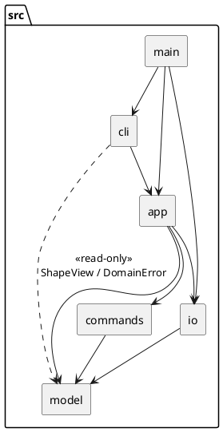

# SVG Editor（CLI）— Lab1 Phase 1

> 状态：**架构方案草案 v0.1**（实现前）。"过程记录 / 一致性自查 / 质量保证手段"三节在实现过程中逐步填写。

## 1. 架构方案

### 1.1 模块划分

技术栈：TypeScript（strict）+ Node 22，运行 `npm run cli`；测试用 vitest；XML 解析用 `@xmldom/xmldom`；依赖检查用 `dependency-cruiser`。

```text
src/
├── model/      领域模型：图形层次（Composite）、文档、领域错误
├── commands/   可撤销的编辑命令（Command 模式）+ 撤销/重做历史
├── io/         SVG 序列化 / 解析、文件系统抽象
├── app/        应用层门面 Editor：会话状态 + 用例入口
├── cli/        命令行外壳：REPL、分词、命令分发、输出渲染
└── main.ts     组合根（Composition Root）：装配各模块
tests/          单元测试 + 会话回放（transcript）测试
doc/README.md   本文档
```

| 模块 | 职责 | 主要类（一类一文件，文件名 = 类名） |
|---|---|---|
| **model** | 表达"文档里有什么"。图形层次、父子关系、id 唯一性、几何变换（move/scale）、属性白名单校验、状态快照（Memento）。**不认识 SVG 文本、不认识命令行、不输出任何文字** | `Shape`（抽象基类）、`Rect` `Circle` `Ellipse` `Line` `Text`、`Group`、`RootGroup`（画布根）、`Document`、`ShapeFactory`、`ShapeSpec`（类型创建说明书）、`ShapeAttributes`、`ShapeState`（Memento）、`NumberCodec`、`StyleInit`、`ShapeView` / `DocumentView`（只读接口）、`DomainError` 及 `errors/` 下的各子类 |
| **commands** | 表达"一次可撤销的编辑"。每条编辑命令一个类，自带 `execute / undo`；`History` 管理撤销栈与重做栈 | `Command`（接口）、`CreateShapeCommand` `DeleteShapeCommand` `MoveCommand` `ScaleCommand` `SetAttributeCommand` `GroupCommand` `UngroupCommand` `AddToCommand` `ZOrderCommand`（`front()` / `back()` 两个静态工厂）、`History`、`NothingToUndoError` `NothingToRedoError` |
| **io** | 表达"文档与外部世界的转换"：Document ⇄ SVG 文本；文件读写经接口隔离，测试时可换成内存实现 | `SvgSerializer`、`SvgParser`、`FileSystem`（接口）、`NodeFileSystem` |
| **app** | 表达"一个编辑会话"：持有当前 Document、History、读入路径、"io 命令后禁止 undo"的栏位；对外提供与界面无关的用例方法（`createShape` `move` `undo` `save`…）。**不打印、不解析命令行**，换 GUI / agent 时可原样复用 | `Editor` |
| **cli** | 表达"文本交互"：读一行、分词（引号、`#` 注释）、查表分发到处理器、把结果渲染为文字（`error:` 前缀、tree、show、help） | `Repl`（只管 I/O 循环）、`Interpreter`（一行文本 → 输出行，含统一错误处理）、`Tokenizer`、`CommandTable`、`CliHandler`（抽象基类）及 `handlers/` 下每条用户命令一个处理器、`TreeRenderer`、`ShowRenderer` |

#### 组件图



#### 核心类关系（model + commands）

```plantuml
@startuml
interface ShapeView {
  +id: string
  +kind: string
  +parent: ShapeView | null
  +children(): ShapeView[]
  +attributes(): [string,string][]
  +describe(): string
}
abstract class Shape {
  +translate(dx, dy)
  +scale(f)
  +setAttribute(name, value)
  +captureState(): Memento
  +restoreState(m)
}
class Group {
  -childList: Shape[]
  +insertChild(s, index)
  +removeChild(s)
  +translate() / scale()  <<递归>>
}
Shape <|-- Rect
Shape <|-- Circle
Shape <|-- Ellipse
Shape <|-- Line
Shape <|-- Text
Shape <|-- Group
ShapeView <|.. Shape
Group o-- "0..*" Shape
class Document { canvas; root: Group; find(id) }
Document *-- Group
class ShapeFactory { create(type, id, attrs) }

interface Command {
  +execute(): string
  +undo(): string
}
Command <|.. CreateShapeCommand
Command <|.. DeleteShapeCommand
Command <|.. MoveCommand
Command <|.. ScaleCommand
Command <|.. SetAttributeCommand
Command <|.. GroupCommand
Command <|.. UngroupCommand
Command <|.. AddToCommand
Command <|.. ZOrderCommand
class History { undoStack; redoStack; run(cmd); undo(); redo() }
History o-- Command
Command ..> Document
@enduml
```

### 1.2 设计模式的选择与落地

| 模式 | 解决什么问题 | 在代码里怎么落地 |
|---|---|---|
| **Command**（必选） | 编辑可撤销 / 重做；一条命令 = 一个 undo 单元 | `Command` 接口：`execute()` / `undo()` 各返回一行结果摘要（如 `circle#c1 moved back to (100,100)`）。每条编辑命令一个类，构造时只保存参数，`execute` 时记录还原所需信息。`History.run(cmd)` 执行成功后入栈并清空 redo 栈；执行抛错则**不入栈**。`group g1 a b c` 是一个 `GroupCommand`，内部记录所有成员原来的（父容器, 下标），一次 undo 全部还原。显示类命令不是 Command，不经过 History |
| **Composite** | 容器与叶子统一操作 | `Shape` 为统一抽象，采用**透明式 Composite**：`children / insertChild / removeChild / indexOf / canUngroup` 直接声明在 `Shape` 上，叶子调用子节点管理方法抛 `not a container`；`Group` 持有 `Shape[]`，其 `translate/scale/setAttribute` 递归转发给子节点。**调用方不写 `if (isGroup)` 也不做类型断言**，命令类只面向 `Shape` 编程。选透明式而非安全式，是因为安全式要求 `Shape` 引用 `Group` 类型，两者互相 import 会形成循环依赖，被依赖检查拒绝 |
| **Memento** | 让 move/scale/set 的 undo 精确还原 | `Shape.captureState()` 返回不透明快照，`restoreState()` 还原；`Group` 的快照递归包含子孙。**不用"反向操作"**：`scale 0.3` 再 `scale 1/0.3` 会有浮点误差，快照则逐位精确 |
| **Factory（简单工厂 + 注册表）** | 类型名 → 图形类；CLI 与 SVG 读入共用同一创建路径 | `ShapeFactory.create(type, id, attrs)`，`attrs` 的键直接用 SVG 属性名（`x y width height fill`…），CLI 位置参数按类型的参数表映射成属性名，`SvgParser` 则直接传 XML 属性 |
| **Facade** | 隔离界面与内核 | `Editor` 是 cli 唯一能调用的入口 |
| **Template Method** | 去重处理器里的参数个数校验、错误转文字 | `CliHandler.run()` 先校验参数个数，再调子类 `execute()`，捕获 `DomainError` 统一加 `error:` 前缀 |

**被明确放弃的方案：Visitor**。序列化和 tree 显示看似适合 Visitor，但 Visitor 要求接口里列出所有具体图形（`visitRect…`），后续插件化阶段新增 `box` 时每个 Visitor 都要改，违背"内核新增代码为 0"。改用：`Shape.kind`（标签名）+ `Shape.attributes()`（有序的属性键值对）+ `Shape.describe()`（tree 内联的几何摘要，如 `x=0 y=0 w=800 h=600 fill=#ffffff`）+ `Group.children()`。`SvgSerializer` 与 `TreeRenderer` 只靠这几个多态方法遍历，不需要认识任何具体图形类。

**按名字分派的两处（作业允许，且须标注为待重构）**

| # | 位置 | 现状 | 待重构方向 |
|---|---|---|---|
| 1 | `cli/CommandTable`：命令名 → 处理器 | `Map<string, CliHandler>` 注册表，不使用 `switch` | 插件阶段改为可注册（`CommandProvider`） |
| 2 | `model/ShapeFactory`：类型名 → 图形类 | `Map<string, ShapeCreator>` 注册表，提供 `register()` | 插件阶段改为 `ShapeProvider` 接口，由插件注册 `box` |

除这两处外，代码中**不得出现按类型名 / 标签名的 `switch` 或 `if-else` 链**，也不得出现 `instanceof` 分派。

### 1.3 依赖方向规则

依赖只能向下，**禁止环**：

```text
main ──► cli ──► app ──► commands ──► model
  │                │                    ▲
  │                └──► io ─────────────┘
  └────────────────────────────────────►(装配)
```

| 模块 | 允许依赖 | 禁止依赖 | 理由 |
|---|---|---|---|
| `model` | 仅语言标准库 | 其余所有模块、任何第三方库 | 领域核心必须可独立理解、独立测试；它不应知道 SVG 文本、命令行或撤销机制 |
| `commands` | `model` | `io` `app` `cli` | 命令只操作文档对象；不碰文件、不碰界面。保证"一个命令"能在无 IO 的单元测试里跑 |
| `io` | `model`、`@xmldom/xmldom` | `commands` `app` `cli` | 序列化只关心 Document ⇄ 文本；格式变化不应波及编辑逻辑 |
| `app` | `model` `commands` `io` | `cli` | 门面不得反向依赖界面，否则换 GUI / agent 时无法复用；`app` 不打印任何文字 |
| `cli` | `app`，以及 `model` 中的 **只读** 部分（`ShapeView`、`DocumentView`、`NumberCodec`、`errors/`） | `commands` `io` | cli 只和门面说话。只读约束由类型保证：`app` 向 cli 返回的是 `ShapeView`，没有任何变更方法 |
| `main` | 所有模块 | — | 组合根，唯一允许认识全部实现类的地方（注入 `NodeFileSystem`、`process.stdin/stdout`） |

补充规则：
1. **`model` 内部**：`Group` 的子节点变更方法（`insertChild / removeChild`）只允许 `commands` 调用，`cli` 看不到（`ShapeView` 不含它们）。
2. **副作用边界**：只有 `io/NodeFileSystem` 与 `cli/Repl` 触碰真实的 fs / stdio，其余模块纯内存，便于测试。
3. **cli 对 model 的访问面是白名单**：`dependency-cruiser` 规则 `cli-reads-model-through-views` 只允许 cli 引用 `ShapeView`、`DocumentView`、`NumberCodec` 与 `errors/`，引用 `Shape`、`Group`、`Document` 等任何可变类型即报错。
4. **执行方式**：用 `dependency-cruiser` 配置上述规则并纳入 `npm test`，违反即视为"待处理项"。

### 1.4 关键设计决策（实现层面）

1. **失败不改状态**：每个 `Command.execute()` 分两段：先**完整校验所有前置条件**（id 是否存在 / 是否重复、目标是否是容器、是否把容器放进自己的子孙、因子是否为正…），全部通过后才开始修改。抛出的 `DomainError` 子类的 `message` 即规范里的错误文本，cli 只加前缀 `error: `。
2. **撤销栏位**：`Editor` 持有 `undoBlockedByIo: boolean`。`init` / `read` / `save` / `canvas <w> <h>` 四条 io 命令执行成功后，一律**清空 undo 与 redo 两个栈**，并置位 `true`；它们本身不入栈、不可被 undo。下一条**编辑命令**成功后复位，此后栈从空开始重新记录。置位时 `undo/redo` 抛 `undo not allowed after io command`。这样 io 命令之后既不能 undo，也不可能越过 io 命令撤销它之前的编辑，与规范 4.3 的字面要求完全一致。不提供 `--ignore-io` 之类的越界参数。**（已确认，见 v0.3）**
3. **id 查找**：`Document.find(id)` 遍历树（O(n)），**不维护 id 索引**——命令行规模下足够，且避免"索引与树不同步"的一类 bug。所有按 id 定位只经此一个入口。
4. **`group` 的落点**：新容器放在**第一个成员原父容器**中、第一个成员原来的位置；成员按文档顺序保持相对顺序。成员父容器不同时，其余成员被拉入第一个成员的父容器。**（已确认）**
5. **`addto` / `group` 的环检测**：目标容器若位于任何被移动图形的子树内，抛 `cannot group a container into its own descendant`。
6. **读入 SVG**：`<rect circle ellipse line text g>` 之外的元素（`path` `defs`…）**跳过并打印 `warning: skipped unsupported element <path>`**；`<g>` 上的 `transform` 作为不透明字符串原样保留并回写，不可通过 `set` 修改（`move/scale` 通过递归修改子节点坐标实现，不改写 `transform`）。
7. **数字输出**：整数不带小数点，浮点去掉累积误差与多余尾零，`-0` 输出为 `0`；统一由 `NumberCodec.format` 处理，解析由 `NumberCodec.parse` 处理（拒绝 `abc`、空串、`NaN`）。
8. **对容器 `set`**：只接受 `fill` / `stroke` / `stroke-width`，并递归设置到全部子孙（规范要求容器与叶子统一操作，但未定义几何属性如何作用于容器，故拒绝 `set g1 x 5`，报 `unknown attribute: x`）。先整体校验后赋值，保证失败不改状态。
9. **画布根是特殊容器**：`Document.root` 是 `RootGroup`（`kind=svg`），不参与 `find`，不能被 `ungroup`；因此用户可以创建 id 为 `svg` 的图形而不冲突。`Document.isTopLevel(shape)` 判断"是否根的直接子节点"，用于 `ungroup` 的 `cannot ungroup top-level container` 检查。
10. **图形创建说明书 `ShapeSpec`**：每个图形类提供静态 `spec()`，包含类型名、位置参数表和构造函数；CLI 的位置参数与 SVG 属性都先归一成"属性名 → 值"再交给同一个构造函数。缺省数值按 SVG 规则取 0。
11. **命令的可重做性与对象身份**：redo 就是对同一个 Command 对象再次 `execute()`。`CreateShapeCommand` / `GroupCommand` 首次执行时创建图形，之后复用同一个对象；`DeleteShapeCommand` 摘下的是原对象并原样放回。这样即使其他命令持有了图形引用，undo → redo 之后引用依然有效。所有命令每次 `execute` 都按 id 重新解析目标。
12. **精确还原靠快照**：`move` / `scale` / `set` 的 undo 都用 `captureState / restoreState`；对容器 `set`，每个子孙回到各自原来的值（不是统一的某个旧值）。
13. **undo 回显文本**（规范只给了 move 与 set 两种，其余为自拟）：`created`↔`removed`；`deleted`↔`restored into <父>`；`moved to (x,y)`↔`moved back to (x,y)`（容器用 `moved by` / `moved back by`）；`group`↔`removed (n children restored)`；`ungroup`↔`restored with n children`；`addto`↔`moved back into <原父>`；`front/back`↔`z-order restored`；`scale`↔`scale undone`。
14. **`group` 的 undo 顺序**：成员按原下标**升序**放回各自原父容器，可证明这样每次放回时前驱位置都未被扰动，从而逐位还原（`tests/commands` 里有交错下标的用例）。

### 1.5 变化点假设

| # | 我认为未来最可能变化的 | 我为它留了什么 | 没留什么、为什么 |
|---|---|---|---|
| 1 | **新增图形类型 / 复合图形 `box`（下一阶段确定会发生）** | ① `ShapeFactory` 注册表 + `register()`；② 序列化走 `kind + attributes()`，新类型不改 `SvgSerializer`；③ `Shape.setAttribute` 是虚方法，`box` 可重写成"传播给子部件"；④ `Shape.describe()` / `kind` 可重写成 `g#n1 (box)`；⑤ 创建参数以"属性名 → 值"传递，不写死位置参数 | 不做插件加载器、不做 `ShapeProvider` 接口——本阶段只有 6 个内置类型，提前抽象会猜错形状（YAGNI）。`ungroup` 拒绝复合图形的判断留给 `Shape.canUngroup()` 虚方法（`Group` 为 `true`，`RootGroup` 为 `false`，将来 `box` 重写为 `false`） |
| 2 | **新增输入通道（GUI / agent / 脚本）** | `Editor` 门面不依赖 cli、不输出文字；cli 的处理器只做"字符串 → 类型化参数 → 调 Editor" | 不做事件总线 / 观察者通知——暂无多视图同步需求 |
| 3 | **新增命令或撤销粒度变化**（如宏命令、命令合并） | `Command` 是接口，`History` 只依赖接口；新增命令 = 新增一个类 + 一个处理器 | 不预先做 `MacroCommand`——`group` 目前自己就是一个单元；出现"一次输入触发多条命令"时再引入 |
| 4 | **文件格式 / XML 库替换** | 所有 XML 细节关在 `io/` 内；fs 经 `FileSystem` 接口注入 | 不抽 `DocumentFormat` 接口——只有 SVG 一种格式，抽出来没有第二个实现可验证 |
| 5 | **输出格式变化**（tree 样式、show 字段、JSON 输出） | 渲染集中在 `cli/TreeRenderer`、`ShowRenderer`，图形只提供 `describe()` / `attributes()` 数据 | 不做可切换主题 / 多种输出格式 |
| 6 | **图形寻址方式**（id → 结构路径，如 `/canvas/g1/rect[2]`） | `Document.find(id)` 是唯一的定位入口 | 本阶段规范明确不要求，不预留路径解析器 |
| 7 | **`transform` 的完整支持** | 解析时保留 `<g transform>` 并回写（不丢数据） | 不支持编辑 / 叠加计算 transform——规范里 `move/scale` 定义为改坐标，支持矩阵会让所有几何方法复杂化 |

### 1.6 待确认的假设（规范未明确，当前采用的取值）

- 读入遇到不支持元素：跳过并警告（见 1.4-6）。
- `create` 的 `fill/stroke` 与 `in` 子句同时出现时的解析：`in` 必须是最后两个 token。

### 1.7 修订记录

| 版本 | 日期 | 变更 | 原因 |
|---|---|---|---|
| v0.1 | 2026-10-18 | 初稿 | — |
| v0.2 | 2026-10-18 | 确认 `save` 后保留 undo 栈（`save` 本身不入栈）；确认 `group` 落在第一个成员的位置 | 消除规范未明确处的歧义 |
| v0.3 | 2026-10-18 | 修订 v0.2：`init` / `read` / `save` / `canvas` 四条 io 命令一律清空 undo 与 redo 栈；曾讨论 `undo --ignore-io` 越界参数，决定不做 | 贴合规范 4.3 的字面要求，规则最简单，避免评测差异 |
| v0.4 | 2026-10-18 | 实现 `model/` 时修订：① Composite 由"安全式"改为"透明式"（子节点管理方法上移到 `Shape`）；② `canUngroup()` 由 `Group` 上移到 `Shape`；③ 新增 `RootGroup`、`ShapeSpec`、`ShapeAttributes`、`ShapeState`、`NumberCodec`、`DocumentView`；④ 新增 1.4 第 8–10 条 | ① 安全式需要 `Shape` 与 `Group` 互相引用，产生循环依赖；② 命令只持有 `Shape`，需要无需类型断言的入口；③④ 实现中暴露的必要抽象与规范未覆盖的取值 |
| v0.5 | 2026-10-18 | 实现 `commands/`：新增 `Shape.anchor()`（move 的回显需要区分叶子与容器）；新增 1.4 第 11–14 条；`ZOrderCommand` 用静态工厂 `front()` / `back()` | 规范的回显格式要求；redo 复用对象以保证引用有效 |
| v0.6 | 2026-10-18 | 实现 `app/` 与 `cli/`：新增 `Interpreter`；cli 对 model 的访问收紧为白名单（新增 dependency-cruiser 规则）；新增 1.4 第 15–18 条；`HelpHandler` 改为接收函数而非 `CommandTable` | 测试与依赖检查中发现的问题（见过程记录） |

15. **Repl 与 Interpreter 分离**：`Interpreter.run(line): string[]` 不碰 stdin/stdout，负责分词、分发、把 `DomainError` 转成 `error: …`，非领域错误以 `error: internal: …` 报告但不中断会话；`Repl` 只做读写循环。这样脚本回放测试直接驱动 Interpreter，I/O 层单独用内存流测试。
16. **`create` 的 `in` 子句**：处理器取"倒数第二个 token 恰为 `in`"作为尾缀，其余全部当位置参数。已知限制：若 text 内容恰好就是 `in` 且紧跟一个 id，会被误判为尾缀（需把内容放进引号并保证其不在倒数第二位）。
17. **tree 的列对齐**：所有带描述的行统一对齐，描述列 = 全树最长"前缀 + 标签"+ 2 空格。规范三份示例中有两份（第 5.1 节、`other.svg` 读入）符合此规则，6.1 节手绘的流程图示例对齐方式不同（按同级分组、间隔 1 空格），属示例自身不一致，以多数示例为准。
18. **运行方式**：`npm run cli` 交互；`npm run cli -- <脚本文件>` 回放脚本；管道输入亦可。非交互输入时，读到的行回显在提示符之后，输出即完整会话记录。额外提供 `exit` 命令（规范未要求），Ctrl+D 同样可退出。

## 2. 过程记录

_（实现过程中填写：AI 给出的建议 / 代码里发现的问题、如何确认与纠正。）_

* 讨论过 undo --ignore-io，因为规范 4.3 要求字面一致、避免扣分而放弃

* **依赖检查抓到我（AI）引入的循环依赖**：`HelpHandler` 为了列出全部命令引用了 `CommandTable`，而 `CommandTable` 又要构造 `HelpHandler`。`dependency-cruiser` 的 `no-circular` 规则报错后，改为 `HelpHandler` 只接收一个"返回处理器列表"的函数。同样的原因，model 层的 Composite 也从"安全式"改成了"透明式"（见 v0.4）。
* **测试发现 `exit` 之后仍执行后续行**：readline 关闭后会继续发出同一块输入里已缓冲的行，导致脚本里 `exit` 后面的命令仍被执行。在行处理函数开头加守卫修复，并留下回归测试。
* **我自己的测试假设错了**：长链 undo/redo 测试里对根级容器 `ungroup`，被规范规定的 `cannot ungroup top-level container` 拒绝。实现没错，错在测试，改为先 `addto` 进另一个容器。
* **规范示例之间互相矛盾**：`tree` 的列对齐在三份示例里不一致，无法同时满足，取多数（见 1.4-17）。

## 3. 一致性自查

_（实现完成后填写：① 实际目录与 1.1 是否一致，不一致处见修订记录；② 1.3 的依赖规则是否被违反，附 dependency-cruiser 结果与抽样检查。）_

## 4. 质量保证手段

_（实现完成后填写：测试策略、transcript 回放、覆盖率、依赖检查等。）_
