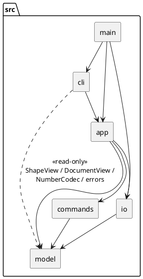

# SVG Editor（CLI）— Lab1 Phase 1

> 状态：功能完成（修订记录至 v0.11）。

```bash
npm install
npm run cli                          # 交互式；exit 或 Ctrl+D 退出
npm run cli -- examples/markers.txt  # 回放脚本（# 开头为注释）；管道输入亦可
npm run check                        # 类型检查 + 依赖规则检查 + 全部测试
```

## 1. 架构方案

### 1.1 模块划分

TypeScript（strict）+ Node 22 + vitest；XML 解析 `@xmldom/xmldom`；依赖规则检查 `dependency-cruiser`。

```text
src/
├── model/       领域模型
│   ├── shape/     图形层次（Composite）、工厂、状态快照、只读视图
│   ├── errors/    领域错误（message 即规范里 `error:` 之后的文本）
│   └── （根）     Document、DocumentView、NumberCodec
├── commands/    可撤销的编辑命令（Command 模式）+ 撤销/重做历史
├── io/          SVG 序列化 / 解析、文件系统抽象
├── app/         应用层门面 Editor：会话状态 + 用例入口
├── cli/         REPL、分词、命令分发、输出渲染
└── main.ts      组合根
tests/  examples/  doc/README.md
```

| 模块 | 职责 | 主要类（文件名 = 类名） |
|---|---|---|
| model | 表达"文档里有什么"；不认识 SVG 文本与命令行，不输出文字 | `Shape` `Rect` `Circle` `Ellipse` `Line` `Text` `Group` `RootGroup` `ShapeFactory` `ShapeSpec` `ShapeState` `ShapeView`；`Document` `NumberCodec`；`errors/*` |
| commands | 表达"一次可撤销的编辑" | `Command`、九个命令类、`History` |
| io | Document ⇄ SVG 文本；文件读写经接口隔离 | `SvgSerializer` `SvgParser` `FileSystem` `NodeFileSystem` |
| app | 表达"一个编辑会话"：当前文档、历史、io 后禁止 undo；不打印 | `Editor` |
| cli | 文本交互：分词、分发、渲染、`error:` 前缀 | `Repl` `Interpreter` `Tokenizer` `CommandTable` `CliHandler` 及每条命令一个 handler、`TreeRenderer` `ShowRenderer` |



```plantuml
@startuml
interface ShapeView {
  +id: string
  +kind: string
  +parent: ShapeView | null
  +children(): ShapeView[]
  +attributes(): [string,string][]
  +describe(): string
}
abstract class Shape {
  +translate(dx, dy)
  +scale(f)
  +setAttribute(name, value)
  +anchor()
  +captureState(): ShapeState
  +restoreState(s)
  +children() / insertChild() / removeChild() / indexOf()
  +canUngroup()
}
note right of Shape
  透明式 Composite：子节点管理方法
  声明在基类，叶子调用时抛 not a container
end note
class Group {
  -childList: Shape[]
  +translate() / scale() / setAttribute()  <<递归>>
}
class RootGroup
Shape <|-- Rect
Shape <|-- Circle
Shape <|-- Ellipse
Shape <|-- Line
Shape <|-- Text
Shape <|-- Group
Group <|-- RootGroup
ShapeView <|.. Shape
Group o-- "0..*" Shape
class ShapeState <<Memento>>
Shape ..> ShapeState
class Document { width; height; root: RootGroup; find(id) }
Document *-- RootGroup
class ShapeSpec { type; fromArguments(); fromAttributes() }
class ShapeFactory { register(spec); create(); createFromAttributes() }
ShapeFactory o-- "0..*" ShapeSpec
ShapeSpec ..> Shape : builds

interface Command {
  +execute(): string
  +undo(): string
}
Command <|.. CreateShapeCommand
Command <|.. DeleteShapeCommand
Command <|.. MoveCommand
Command <|.. ScaleCommand
Command <|.. SetAttributeCommand
Command <|.. GroupCommand
Command <|.. UngroupCommand
Command <|.. AddToCommand
Command <|.. ZOrderCommand
class History { undoStack; redoStack; run(cmd); undo(); redo() }
History o-- Command
Command ..> Document
class Editor <<Facade>>
Editor --> History
Editor --> Document
@enduml
```

### 1.2 设计模式的选择与落地

| 模式 | 作用 | 落地 |
|---|---|---|
| Command | 可撤销 / 重做；一条命令 = 一个 undo 单元 | `Command{execute, undo}` 各返回一行摘要；`History` 成功后入栈并清 redo 栈，失败不入栈；`group` 整体是一个 `GroupCommand` |
| Composite | 容器与叶子统一操作 | `Shape` 声明子节点管理方法（透明式），`Group` 递归转发 move / scale / set，调用方没有 `if (isGroup)`。不用安全式：它要求 `Shape` 引用 `Group`，两者互相 import 成环 |
| Memento | undo 精确还原 | `captureState` / `restoreState`；不用反向运算（`scale 0.3` 再 `scale 1/0.3` 会有浮点误差） |
| Factory | 类型名 → 图形；CLI 与 SVG 读入共用 | `ShapeFactory` 持有"类型名 → `ShapeSpec`"注册表；位置参数与 XML 属性都归一成"属性名 → 值" |
| Facade | 隔离界面与内核 | `Editor` 是 cli 唯一入口 |
| Template Method | 去重参数个数校验 | `CliHandler.run()` 校验后调子类 `execute()` |

**放弃 Visitor**：它要在接口里列出所有具体图形，下阶段加 `box` 时每个 Visitor 都要改。序列化与 tree 改用 `kind` + `attributes()` + `describe()` + `children()`，不认识任何具体图形类。

### 1.3 依赖方向规则

依赖只能向下，禁止环。

| 模块 | 可依赖 | 不可依赖 | 理由 |
|---|---|---|---|
| model | （仅标准库） | 其余模块、第三方库 | 领域核心可独立理解与测试 |
| commands | model | io app cli | 命令只改文档，不碰文件与界面 |
| io | model、`@xmldom` | commands app cli | 格式变化不波及编辑逻辑 |
| app | model commands io | cli | 换 GUI / agent 时门面可复用 |
| cli | app；model 的只读白名单 | commands io | 只和门面对话 |
| main | 全部 | — | 组合根 |

- **cli 对 model 的白名单**：只能引用 `shape/ShapeView`、`DocumentView`、`NumberCodec`、`errors/`，引用 `Shape`、`Group`、`Document` 等可变类型即报错。
- **model 内部单向**：`errors` ← `NumberCodec` ← `shape` ← `Document`。图形不应知道自己装在哪份文档里。
- **强制**：以上写成 `.dependency-cruiser.cjs` 的规则（含"无环"与"XML 库只能在 io 用"），由 `npm run check` 执行；违反即为待处理项。

### 1.4 变化点假设

| # | 可能的变化 | 留了什么 | 没留什么（原因） |
|---|---|---|---|
| 1 | 新图形 / 复合图形 `box`（下阶段必然） | `ShapeFactory.register`；序列化走 `kind` + `attributes()`；`setAttribute` `describe` `canUngroup` 是虚方法，可重写 | 不做插件加载器与 `ShapeProvider`：现在只有 6 种，过早抽象会猜错形状 |
| 2 | 新输入通道（GUI / agent） | `Editor` 不依赖 cli、不输出文字 | 不做事件总线：暂无多视图同步 |
| 3 | 新命令 / 撤销粒度 | `Command` 接口；加命令 = 加类 + handler | 不预建 `MacroCommand`：`group` 自己就是一个单元 |
| 4 | 文件格式 / XML 库 | XML 细节关在 io；fs 经接口注入 | 不抽 `DocumentFormat`：只有 SVG 一种 |
| 5 | 输出格式 | 渲染集中在 `TreeRenderer` `ShowRenderer` | 不做主题 / 多格式 |
| 6 | 寻址方式（路径） | `Document.find` 是唯一入口 | 规范不要求，不留解析器 |
| 7 | 完整 `transform` | 读入保留 `<g transform>` 并回写 | 不支持编辑 / 叠加：会让所有几何方法复杂化 |

### 1.5 关键决策与规范未明确处的取值

1. **失败不改状态**：命令先完整校验再修改；错误类的 `message` 即规范文本，cli 只加 `error: `。
2. **io 命令之后**：`init` `read` `save` `canvas <w> <h>` 成功后清空 undo / redo 栈并禁止 undo，下一次成功编辑才解除。不提供 `--ignore-io` 之类的越界参数。
3. **`group` 落点**：新容器放在第一个成员原来的父容器与位置；成员按文档顺序；成员父容器不同时，其余成员被拉进这个父容器。`group` 的 undo 按原下标升序放回，才能逐位还原。
4. **环检测**：`group` / `addto` 的目标位于被移动图形的子树内时，报 `cannot group a container into its own descendant`。
5. **按 id 查找**用遍历（O(n)），不维护索引，避免索引与树不同步。
6. **对容器 `set`**：只接受 `fill` `stroke` `stroke-width`，并递归到全部子孙；其余属性报 `unknown attribute`。
7. **画布根是 `RootGroup`**：不参与 `find`、不能 `ungroup`。
8. **redo = 对同一个 Command 再次 `execute`**：`Create` / `Group` 复用首次创建的图形对象，`Delete` 放回原对象，保证其他命令持有的引用在 undo → redo 后仍有效。
9. **读入 SVG**：只认 6 种元素，其余元素整棵子树跳过并警告；图形不认识的**属性**（`rx` `font-size` `opacity`…）静默丢弃，所以 `read` → `save` 有损；缺 id 分两遍补（先收集全部显式 id），补出的 id 不会撞上文件后面的显式 id；`<g transform>` 原样保留，不可编辑。
10. **`read` / `save` 原子**：失败时文档、历史、默认路径都不变。`read` / `save <f>` 成功后 `<f>` 成为默认路径，`init` 清除；`(N elements)` 的 N 不含 `<svg>` 根。
11. **回显文本**：规范只给了 move 与 set，其余自拟——`created ↔ removed`、`deleted ↔ restored into <父>`、`group ↔ removed (n children restored)`、`ungroup ↔ restored with n children`、`addto ↔ moved back into <原父>`、`front/back ↔ z-order restored`、`scale ↔ scale undone`。
12. **`tree` 列对齐**：描述列 = 全树最长"前缀 + 标签"+ 2 空格。规范三份示例里两份符合，6.1 节手绘的示例对齐方式不同，属示例自相矛盾，取多数。
13. **`create ... in <容器>`**：倒数第二个 token 恰为 `in` 时视为子句，其余都是位置参数。已知限制：text 内容恰为 `in` 且后面紧跟 id 时会被误判。
14. **`init` / `canvas` 参数**：要么 0 个要么 2 个，只给一个报用法错误（**用户确认保持严格**）。
15. **数字输出**：整数不带小数点，去掉浮点误差与尾零，`-0` 输出 `0`（`NumberCodec`）。

### 1.6 修订记录

| 版本 | 日期 | 变更 |
|---|---|---|
| v0.1 | 10-18 | 初稿 |
| v0.2 | 10-18 | 确认 `save` 后保留 undo 栈、`group` 落点 |
| v0.3 | 10-18 | 改为 io 命令一律清栈；不做 `--ignore-io` |
| v0.4 | 10-18 | 实现 model：Composite 由安全式改透明式（避免循环依赖）；`canUngroup` 上移到 `Shape`；新增 `RootGroup` `ShapeSpec` `ShapeState` `NumberCodec` `DocumentView` |
| v0.5 | 10-18 | 实现 commands：`Shape.anchor()`（move 回显）；`ZOrderCommand` 用静态工厂 |
| v0.6 | 10-18 | 实现 app / cli：新增 `Interpreter`；cli 对 model 收紧为白名单；`HelpHandler` 改接收函数（避免循环） |
| v0.7 | 10-18 | 实现 io：`Editor` 注入 `FileSystem`；填写第 3、4 节 |
| v0.8 | 10-20 | 新增规范两个完整会话的回放测试 |
| v0.9 | 10-20 | `model/` 内部整理：14 个图形文件移入 `model/shape/`；新增 model 内部分层规则 |
| v0.10 | 10-20 | 整体检查：修 `main.ts` 缺失脚本崩溃；新增端到端与随机会话测试；修正文档与代码不符之处 |
| v0.11 | 10-20 | 精简本文档（章节按规范四项重排，决策合并为 1.5） |

## 2. 过程记录

本项目由用户（学生）与 AI 智能体 Claude Code（下称 Agent）协作完成。**[用户]** 表示用户提出、决定或发现；**[Agent]** 表示 Agent 自己发现并处理。

### 2.1 用户的决策与要求

- **[用户]** `save` 后的 undo：先主张"保留栈，但 `save` 本身不可 undo"，随后提出 `undo --ignore-io` 参数，使用户能越过 `save` 撤销它之前的非 io 命令。Agent 评估可行，但指出默认行为必须与规范 4.3 逐字一致。**用户最终决定放弃该参数、io 命令一律清栈，以免扣分**（1.5-2）。
- **[用户]** `group` 的落点：Agent 用例子说明规范未定义，用户选"第一个成员的位置"（1.5-3）。
- **[用户]** 要求把 `model/` 里图形相关文件收进 `model/shape/`。Agent 先核对依赖（没有图形类引用 `Document`），建议 `Document` / `NumberCodec` 留在根；用户采纳。
- **[用户]** Agent 提出：init 命令规范写的是 `init [w] [h]`，两个参数都是可选的，也可以理解为 `init 400` 合法、高度取默认 600。用户觉得：应该保持严格模式，要么两个同时出现，要么两个不出现，不能够出现未定义的动作。因此 `init` / `canvas` 的单参数问题：保持严格（1.5-14）。
- **[用户]** 要求精简本文档、区分用户与 Agent（v0.11）。

### 2.2 用户发现的 Agent 疏漏

- **[用户→Agent]** 追问"规范第 6、6.1 节两个完整会话是否做成了回放测试"。Agent 核对后承认只做了一半：第 6 节漏了一次 `tree`，6.1 节分散在两个文件且缺 `tree` 与 `save`，也没有用真正的 `Repl` 验证整份会话文本。已补 `transcripts/SpecTranscripts.test.ts`（Interpreter 与 Repl 两种回放）。

### 2.3 Agent 自己发现并纠正的问题

1. **循环依赖（Shape ⇄ Group）**：安全式 Composite 要求两个文件互相 import。设计阶段评估后改为透明式（v0.4）。
2. **循环依赖（HelpHandler ⇄ CommandTable）**：Agent 写出，`dependency-cruiser` 的 `no-circular` 当场报错；改为 `HelpHandler` 只接收"返回 handler 列表"的函数。
3. **`exit` 后仍执行后续行**：回放测试暴露——readline 关闭后仍会发出同一块输入里已缓冲的行。加守卫并留回归测试。
4. **第三方库行为与假设不符**：Agent 原以为在 `xmldom` 的 `onError` 里抛自己的错即可；测试显示会被二次包装成 `internal` 错误。先用小脚本探测库的真实行为，再改为"记录第一个错误 + 捕获 `ParseError`，统一转 `invalid svg`"。
5. **规范示例互相矛盾**：`tree` 的列对齐在三份示例里不一致。逐份对照后取多数（1.5-12）。
6. **覆盖率暴露盲区**：首次 92%，`Ellipse` 仅 27%，`addto` / `back` 从未经 CLI 测试。补参数化的图形测试与 handler 测试，升到 98%。
8. **Agent 两次写错测试预期**（实现没错）：对根级容器 `ungroup`，被规范规定的 `cannot ungroup top-level container` 拒绝；`create rect ... in` 里 `in` 被当作可选的 `fill`。都改了测试而非实现。
9. **整体检查的发现**：
   - `npm run cli -- 不存在的脚本` 带着流错误堆栈崩溃（进程内测试覆盖不到 `main.ts`）；改为经 `NodeFileSystem` 读入，并补端到端测试。
   - 文档：1.4 的第 15–22 条被错放到修订记录之后、类图是旧版本、工厂 / 模板方法两行与代码不符、"纳入 `npm test`" 实为 `npm run check`。
   - 随机会话测试的第一版生成器几乎全是失败（`ungroup` 成功 0 次），被测试里的统计断言抓出，改为感知当前文档的生成器。

## 3. 一致性自查

> 截至 v0.11 的一次自查

### 3.1 模块划分：实际目录与方案是否一致？

**一致。** `src/` 下五个模块目录加 `main.ts` 与 1.1 完全对应。差异都在模块内部，已记入修订记录：

| 差异 | 记录 |
|---|---|
| model：透明式 Composite，新增 `RootGroup` `ShapeSpec` `ShapeState` `NumberCodec` `DocumentView` | v0.4 |
| `Shape.anchor()`；commands 新增 `NothingToUndoError` `NothingToRedoError` | v0.5 |
| cli 新增 `Interpreter` `ReplOptions` | v0.6 |
| io 新增 `ParseResult` 与三个错误类；`Editor` 注入 `FileSystem` | v0.7 |
| `model/` 内新增 `shape/` 子目录 | v0.9 |

"一类一文件、文件名 = 类名"用脚本检查过：88 个源文件全部符合（曾有两处接口与类同文件，已拆出）。

### 3.2 依赖方向：规则有没有被违反？

**没有。**
- **工具**：`npm run deps` 报告 `no dependency violations found`（92 个模块、257 条依赖）。还逐条植入了违规依赖（`model → cli`、`shape → Document`、`cli → model/shape/Shape`、`errors → NumberCodec`、`NumberCodec → shape`），确认每条规则都会报错，再还原。
- **抽样**（脚本统计 import 数）：`commands→model` 33；`io→model` 11；`app→commands / io / model` 11 / 3 / 8；`cli→app` 22；`cli→model` 12（全部在白名单内）；`main→app / cli / io` 各 1；其余方向均为 0。
- **过程中曾违反**：`HelpHandler ⇄ CommandTable` 循环依赖，被 `no-circular` 拦下并修复（2.3-2）。

### 3.3 规范禁令

| 规范要求 | 检查 | 结果 |
|---|---|---|
| 禁止按类型名 `switch` / `instanceof` 分派 | `grep src/` | `switch` 只出现在 5 个叶子图形的 `setOwnAttribute`，分派的是**属性名**（白名单）；`instanceof` 只用于判断 `Error` |
| 按名字分派只有两处且标注待重构 | 审阅 | `CommandTable`、`ShapeFactory`，注释与 1.2 均已标注 |
| 容器与叶子统一操作 | 测试 | move / scale / set / delete 走同一个命令类，无 `if (isGroup)` |
| 命令失败不改变状态 | 测试 | 每个错误场景比对前后整棵树快照与 undo 深度；随机会话再验证 |

## 4. 质量保证手段

### 4.1 功能是否完整

规范命令总表的 19 条命令全部实现并各有测试；4.2 节 11 种错误文本逐字有断言（分布在 `Interpreter` `StructureCommands` `SessionWithIo` `SpecTranscripts` 测试中）；4.4 节 `box` 属后续阶段，本阶段报 `unknown shape type`，有测试。

以规范的完整 transcript 为验收标准（逐行断言，不是"大致像"）：

| 来源 | 测试 | 结果 |
|---|---|---|
| 第 6 节完整会话（含 `save` / `read other.svg` / 补 id 警告） | `SpecTranscripts` | 命令与输出逐字一致；Interpreter 逐步断言 + Repl 整份文本断言 |
| 6.1 节流程图版本 A | `SpecTranscripts` | 同上；仅 `tree` 列对齐不同（1.5-12），测试保留规范原文并只忽略标签与属性间的空格数 |
| 0.1 节最小 SVG、`transform` 示例、`other.svg` | `SvgSerializer` `SvgParser` | 生成的文本与规范逐字节相同；读入后的树与规范一致 |

### 4.2 对代码质量的信心

| 手段 | 结果 |
|---|---|
| 单元 / 集成测试（vitest） | 18 个文件、228 个用例，全部通过 |
| 覆盖率（v8，不含 `main.ts`） | 语句 98.2%，分支 92.3%，函数 97.2% |
| 类型检查（strict + `noUncheckedIndexedAccess` + `noImplicitOverride`） | 0 错误 |
| 架构约束（dependency-cruiser） | 0 违反；曾拦下一次循环依赖 |
| 端到端（真正启动 `main.ts`） | 脚本回放、管道输入、缺失脚本文件、`exit` 均通过 |
| 随机会话（固定种子，感知文档的命令生成） | 300×40 + 15×150 步会话、100 个往返用例通过 |

**随机会话**每步核对：失败命令不改变文档（完整精度快照，浮点漂移也能发现）；undo / redo 严格按游标模型回到之前的快照，io 命令后被拒；树结构一致；`save → read → save` 逐字节相同。测试末尾的统计断言要求每类命令至少成功 100 次，防止生成器退化。

**测试有效性验证**：多次临时破坏实现，确认测试会失败，再还原——undo 回显文本、`tree` 的竖线字符、`group` 的 undo 顺序、`move` 改用反向平移、旧版 `main.ts`、各条依赖规则。

### 4.3 已知局限

- `tree` 列对齐无法同时满足规范中互相矛盾的示例（1.5-12）。
- `read` → `save` 静默丢弃图形不认识的属性（1.5-9）。
- undo / redo 回显文本，除 move 与 set 外为自拟（1.5-11），若评测逐字比对可能不符。
- 交互式终端（TTY）无自动化测试，由用户手动验证过。
- 覆盖率未覆盖的约 2% 主要是防御性分支。
